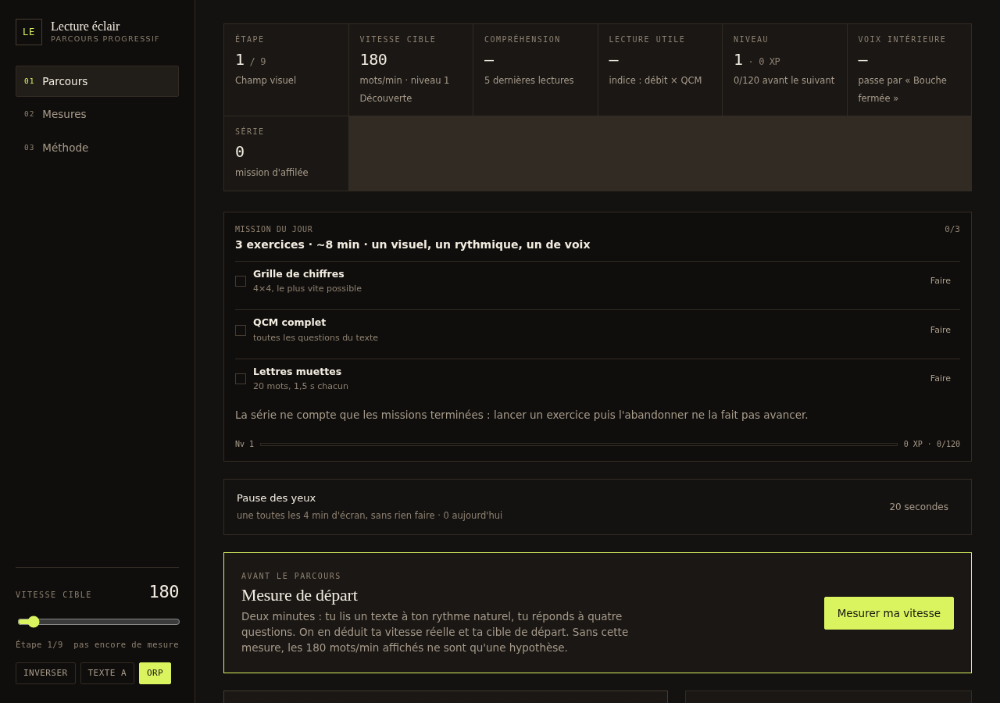

# flashR



Application web autonome (un seul fichier, sans dépendance, sans réseau) pour travailler la lecture rapide **sans sacrifier la compréhension**.

> Documentation en anglais : [`README.md`](README.md). Démo : **https://tournierjc.github.io/flashR/**

## Ouvrir

```
xdg-open /opt/data/flashR/index.html
```

ou glisser `index.html` dans un navigateur. Fonctionne hors ligne. Si un navigateur refuse de garder les données en `file://`, servir le dossier :

```
python3 -m http.server 8000 --directory /opt/data/flashR
```

## Le jeu

- **Mission du jour** — trois exercices tirés au sort chaque jour (un visuel, un rythmique, un de voix intérieure), ~8 min. La série n'avance que sur une mission terminée ; lancer puis abandonner ne compte pas.
- **XP et niveaux** — 8 à 20 XP par exercice selon la justesse, ×2 / ×3 quand les bonnes réponses s'enchaînent dans un même quiz. ~120 XP pour le niveau 2, puis 180, 240…
- **Série** — nombre de missions consécutives terminées, avec règle de la veille (une journée manquée remet à 1).

## Le parcours (progressif)

Neuf étapes dans l'ordre : l'outil d'abord (champ visuel, fixations), le rythme et la prise de groupes ensuite, la voix intérieure, la vitesse en dernier. Chacune a un objectif, des exercices imposés et un **critère de passage chiffré** :

1. **Champ visuel** — grille de chiffres 4×4 < 26 s et grille de lettres A→P < 28 s
2. **Fixations guidées** — 2 séquences de saccades justes sur 3 + un texte suivi à l'indicateur visuel, 3/4
3. **Rythme au métronome** — une lecture au métronome à 200, 3/4
4. **Flux continu** — lecture guidée à 220, 3/4
5. **Empan large** — empan stable à 5 mots + Flash 2 mots à 250, 3/4
6. **Voix intérieure** — lecture sous boucle articulatoire à 250, 3/4 ; lettres muettes 15/20 avec une médiane sous 1,1 s. L'écart avec le contrôle est **affiché à titre indicatif** : il ne bloque pas l'étape (la voix reste utile sur un texte dense)
7. **Comprendre sous vitesse** — deux lectures guidées à 280, 3/4
8. **Vitesse soutenue** — deux Flash à 320, 3/4
9. **Lecture réelle** — rappel libre ≥ 50 % des idées clés **et** au moins 25 mots rédigés ; la vitesse réelle de lecture est enregistrée à côté

Les critères ne se valident que sur des passages **récents** (deux ou trois derniers essais) et **à la cible exacte** de l'étape : un vieux record ou un essai 20 mots/min sous la cible ne suffit pas. Une étape non validée se refait.

La vitesse cible monte de **+20 mots/min** après 3 ou 4 bonnes réponses sur 4 avec un rythme supportable, reste stable à 2/4, redescend de 20 en dessous — et **seules les lectures avec questions la déplacent** : une grille, des saccades ou un empan réussi ne la font pas bouger. Le plancher d'une étape ne s'applique qu'une fois, pour ne pas effacer une baisse méritée.

## Exercices (libres, hors parcours)

**Lecture** : Flash RSVP (groupes d'1 à 8 mots, ancrage ORP ; le groupe suit le palier de vitesse — 2 mots à 300, 4 à 520, 6 à 800, 8 à 1000), **lecture guidée** (curseur vertical qui balaie la ligne, texte lu effacé — pas de point de fixation), **métronome deux points** (les groupes s'allument alternativement à gauche et à droite, l'œil traverse le champ à chaque battement ; le groupe suit le même réglage « mots par affichage » que le Flash, de 1 à 8, donc il grandit avec le palier de vitesse), lecture + rappel libre.

**Fixations et vision** : **grille de chiffres** (4×4 → 1 à 16, 5×5 → 1 à 25), **grille de lettres** (4×4 → A à P, 5×5 → A à Y), **saccades guidées** (lettres flashées sur 4 ancres, séquence à restituer), **vision périphérique** (fixation centrale, lettre flashée hors du centre puis masquée, durée d'exposition auto-adaptative), **indicateur visuel** (un point de fixation sous chaque groupe de 3 mots, au centre du groupe), **empan visuel** (exposition fixe 600 ms, escalier 2 réussites sur 3 pour monter), **empan vertical** (colonne de 4 à 7 mots, deux flèches au centre, exposition 750 ms, escalier 2 sur 3).

Sur les grilles, le retour visuel dépend du niveau : **débutant**, une case trouvée reste verte ; **avancé**, elle flashe vert puis redevient neutre (la mémoire de la grille doit rester dans la tête). Une mauvaise case passe au rouge un tiers de seconde, est comptée comme erreur, et n'empêche rien.

**Voix intérieure** : **bouche fermée** (contrôle lu normalement puis lecture en répétant « ta-ta-ta » — suppression articulatoire : l'écart de compréhension entre les deux dit à quel point le sens dépend de la voix) et **lettres muettes** (ce mot a-t-il une lettre muette ? impossible de répondre en l'entendant, il faut voir l'orthographe ; on mesure la justesse et la médiane de réponse).

## Bibliothèque de textes

`textes.js` (à côté d'`index.html`) contient la bibliothèque : un tableau `window.BIBLIO` de textes, servis sans réseau.

- **100 textes**, cinq niveaux (180 à 1500 mots selon le niveau), sur la douzaine de thèmes listés dans `textes/SPEC.md`. Les textes longs (niveau 5, jusqu'à 1500 mots) servent au test de compréhension complet ; les lectures chronométrées se limitent aux textes de moins de 600 mots.
- **15 à 27 questions par texte** (faits explicites, inférences, idée principale), trois options, explication après chaque réponse.
- Après une lecture chronométrée, l'app tire **4 à 7 questions au hasard** — à 300 mots/min, un QCM de 20 questions mesurerait la patience. L'exercice **Lecture + QCM complet** pose toutes les questions du texte, sans chronomètre.
- Tirage **aléatoire par niveau**, jamais les six derniers textes vus, et le moins lu d'abord.

Ajouter des textes :

```
# 1. écrire un objet dans le tableau de textes.js (schéma : textes/SPEC.md)
node textes/valide-biblio.js textes.js     # longueurs, questions, options, doublons
node --check textes.js                     # syntaxe
# 2. recharger l'app
```

Un dossier `textes/` regroupe la spécification, le validateur et les fichiers de travail (`partA.json` … `partD.json`) ; `node textes/fusionne.js` recompose `textes.js` à partir d'eux. Si `textes.js` est absent, l'app tourne sur dix textes de secours intégrés — elle ne casse jamais.

## Pauses des yeux

L'app ouvre une pause **entre deux exercices** (jamais au milieu d'un quiz) après un temps d'écran cumulé : **4 minutes pour un débutant, 7 pour un lecteur avancé**. Quatre méthodes tournent :

- **Regarde au loin** (20 s) — un point à plus de 6 m : relâchement de l'accommodation, la règle 20-20-20 ;
- **Cligne lentement** (15 s) — dix clignements complets ; on cligne 2 à 3 fois moins devant un écran ;
- **Paumes sur les yeux** (20 s) — palming, noir complet, sans appuyer ;
- **Près / loin** (25 s) — huit allers-retours entre un doigt à 40 cm et un point lointain.

Un bouton « 20 secondes » sur le tableau de bord les ouvre à la demande, un compteur donne les pauses du jour, et les pauses automatiques se coupent dans les réglages (`Pauses des yeux auto`). « Plus tard » repousse de 2 minutes.

## Mesures

- **Lecture utile = débit × compréhension** — un *indice* de comparaison entre séances, pas une mesure du regard (280 mots/min à 75 % → 210). La vitesse cible va de **120 à 1000 mots/min**, en dix paliers (Découverte, Apprenti, Lecteur, Rapide, Véloce, Éclair, Vision, Fusée, Hyper, Limite) ; les mots par affichage suivent le palier, de 1 à 8.
- **Voix intérieure = écart de compréhension contrôle → boucle** — « +0 pts » veut dire que la boucle ne coûte rien (la lecture se passe du son) ; « −50 pts » veut dire que la voix porte encore le sens. Les passages sous boucle ne comptent ni dans la moyenne « lecture utile » ni dans l'adaptation de vitesse : c'est un diagnostic, pas une performance.
- **Progression journalière** : chaque séance est horodatée ; la vue « Progression » agrège par jour (séances, temps, compréhension moyenne, indice moyen, écart avec la dernière journée mesurée) et la bande des 7 derniers jours reste sur le tableau de bord. Une journée sans séance ne fait pas baisser la courbe.
- Mesure de départ : lecture libre chronométrée + 4 questions → vitesse naturelle réelle, cible initiale.
- Empan : longueur maximale réellement affichée et réussie.
- Grilles : temps de balayage, meilleur temps conservé par type (chiffres / lettres).
- Saccades : séquences justes sur 3. Périphérie : identification à une durée d'exposition donnée.
- Rappel libre : couverture des idées clés estimée par recoupement lexical, plus le débit réel de la lecture.

## Données

Tout est stocké dans `localStorage` (`flashR.v1`, avec reprise automatique d'une sauvegarde `lectureEclair.v1` si elle existe) : aucune requête réseau, aucun compte. L'historique complet des séances est conservé (date, vitesse, compréhension, indice). Deux exports : **CSV** des séances (tableur) et **JSON** de la sauvegarde complète, restaurable via le sélecteur de fichier. « Effacer mes données » remet le parcours à zéro.

Le format du parcours est versionné (`parcoursV`) : si la liste des étapes change, les journaux d'étapes sont réinitialisés mais l'historique des séances est conservé.

## Limites assumées

- 4 questions par texte = un échantillon, pas une preuve de compréhension profonde ; les questions portent surtout sur des faits explicites.
- Le score de rappel est une heuristique par mots-clés : une reformulation juste avec d'autres mots peut être sous-notée.
- Sans oculométrie, rien ici ne mesure les mouvements oculaires réels : « fixations », « saccades » et « flux continu » sont des tâches attentionnelles qui les sollicitent, pas des mesures du regard.
- Sans micro ni électrodes sur la gorge, la subvocalisation n'est pas mesurée : l'indice « voix intérieure » est un écart de compréhension avec et sans boucle articulatoire (indice indirect), pas une mesure de l'articulation. Deux textes différents sont comparés : leur difficulté inégale ajoute du bruit, d'où le seuil large de 25 points.
- La boucle « ta-ta-ta » fatigue : sur un texte dense, la voix reste utile. L'objectif est de pouvoir s'en passer quand on veut aller vite, pas de la supprimer tout le temps.
- Cent textes : le tirage évite les six derniers vus, mais sur plusieurs mois tu recroiseras des textes — et un texte déjà lu biaise la mesure de compréhension.
- La moyenne journalière mélange les exercices faciles et difficiles ; c'est la tendance sur deux semaines qui compte, pas l'écart d'un jour.
- Aucune valeur clinique ou scolaire.
