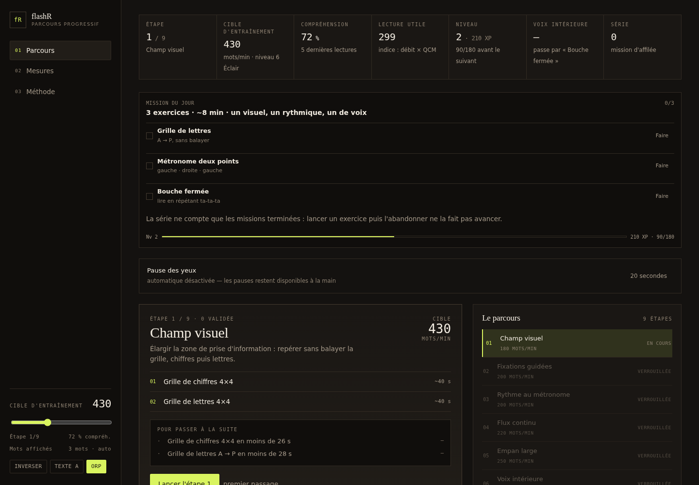

# flashR

[](https://tournierjc.github.io/flashR/)
[](LICENSE)

**▶ Try it now: https://tournierjc.github.io/flashR/** — same file as the local one, nothing to install.



A self-contained, offline web app for training **reading speed without sacrificing comprehension**.

One HTML file, one data file, no build step, no dependency, no network call. Everything is stored locally in `localStorage` — no account, no telemetry.

> The app interface is in **French** (the audience and the texts are French). This README is in English; the French documentation is in [`README.fr.md`](README.fr.md).

## Live demo

GitHub Pages: **https://tournierjc.github.io/flashR/**

It is the same file that runs locally — the library is loaded from `textes.js`, nothing else is fetched.

## Run locally

```bash
git clone https://github.com/tournierjc/flashR.git
cd flashR
xdg-open index.html        # or drag index.html into a browser
```

Opening `index.html` directly (`file://`) works. Some browsers refuse `localStorage` on `file://`; in that case serve the folder:

```bash
python3 -m http.server 8000
# then open http://localhost:8000/
```

`textes.js` must stay next to `index.html`. If it is missing, the app falls back to ten built-in texts and keeps working.

## What it does

Nine-step progression, a calibrated starting speed, a daily mission with XP and streak, and a measurement log. Speed is only ever raised on **reads that come with comprehension questions**: a fast grid or a successful span exercise never moves it.

### Daily mission and game layer

- **Daily mission** — three exercises drawn each day (one visual, one rhythmic, one inner-voice), about 8 minutes. The streak only advances on a completed mission; starting and abandoning does not count.
- **XP and levels** — 8 to 20 XP per exercise, ×2/×3 on consecutive right answers inside a quiz. ~120 XP for level 2, then 180, 240…
- **Streak** — consecutive completed missions, with a "missed yesterday" rule that resets it to 1.

### The nine steps

Order matters: the visual tool first, then rhythm and word grouping, then the inner voice, speed last. Every step has a numeric pass criterion, measured on recent attempts at the exact target speed — an old record or a run 20 wpm below target does not count.

| # | Step | Pass criterion |
|---|------|----------------|
| 1 | Visual field | digit grid 4×4 < 26 s and letter grid A→P < 28 s |
| 2 | Guided fixations | 2/3 correct saccade sequences + guided text 3/4 |
| 3 | Metronome rhythm | metronome read at 200 wpm, 3/4 |
| 4 | Continuous flow | guided reading at 220 wpm, 3/4 |
| 5 | Wide span | span stable at 5 words + 2-word flash at 250 wpm, 3/4 |
| 6 | Inner voice | reading under articulatory loop at 250 wpm, 3/4; silent letters 15/20 with median under 1.1 s |
| 7 | Understanding under speed | two guided reads at 280 wpm, 3/4 |
| 8 | Sustained speed | two flashes at 320 wpm, 3/4 |
| 9 | Real reading | free recall ≥ 50 % of key ideas **and** at least 25 words written |

Target speed moves **+20 wpm** after 3 or 4 correct answers out of 4 with comfortable rhythm, stays put at 2/4, drops 20 below that.

### Speed range

**120 to 1000 wpm**, ten tiers: Découverte, Apprenti, Lecteur, Rapide, Véloce, Éclair, Vision, Fusée (650), Hyper (800), Limite (1000). Words per display follow the tier — 2 words at 300, 4 at 520, 6 at 800, 8 at 1000 — and the manual setting (1 to 8) can only raise that floor.

## Exercises

Every free exercise opens a small **settings sheet** before it starts — speed, words per display, number of trials, starting length, exposure time, grid size — and the choices are remembered per exercise for next time. A **⟲ Recommencer** button in the stage bar restarts the same exercise with the same settings at any moment; **Refaire** on the result screen does the same once it is over.

**Reading**

- **RSVP flash** — 1 to 8 words, single fixed anchor (ORP) while the group fits one word, plain centred group beyond that.
- **Guided reading** — a vertical cursor sweeps the line at constant speed and the text already read **disappears completely** (opacity 0, width preserved): no fixation dot, no going back, no rereading.
- **Two-anchor metronome** — two fixation points, left and right; word groups light up alternately at one then the other, on the beat. The group follows the same "words per display" setting, so it grows with the tier. The eye must cross the whole field on every beat instead of drifting in the middle.
- **Reading + free recall** — write what you remember; coverage of key ideas is estimated by lexical overlap.

**Fixations and vision**

- **Digit grid** — 4×4 (1 to 16) then 5×5 (1 to 25). **Letter grid** — 4×4 (A to P) then 5×5 (A to Y).
- **Guided saccades** — letters flashed on four anchors, sequence to reproduce.
- **Peripheral vision** — central fixation, letter flashed off-centre then masked, self-adapting exposure time.
- **Visual indicator** — one fixation dot centred **under** each three-word group; groups never wrap onto two lines.
- **Visual span** — fixed 600 ms exposure, staircase up on 2 successes out of 3.
- **Vertical span** — a column of 4 to 7 words with two arrows marking the fixation point, 750 ms exposure; the question asks for the **top or bottom** word, i.e. the vertical peripheral reach.
- **Visual fan** — a number of 2 to 8 digits is flashed, then you type it back; exposure shrinks as the number grows (420 ms for two digits, 180 ms for eight). Three successes in a row lengthen the number, two misses shorten it. Same idea as the book exercise: shorten the fixation while widening what one fixation takes in.

Grid feedback depends on level: for a beginner a found cell stays green; for an advanced reader it flashes green then returns to neutral (the grid must be held in memory). A wrong cell turns red for a third of a second, counts as an error, and blocks nothing.

**Inner voice**

- **Closed mouth** — a control text read normally, then the same exercise while repeating "ta-ta-ta" mentally. The comprehension gap between the two says how much meaning still depends on the inner voice.
- **Silent letters** — "does this word have a silent letter?"; impossible to answer by hearing it, you have to see the spelling. Answered on the keyboard: **O / N**, **1 / 2**, or **← / →**. Measures accuracy and median response time.

### Text library

`textes.js` holds `window.BIBLIO`: 100 French texts, five levels (180 to 1500 words), each with 15 to 27 multiple-choice questions (explicit facts, inferences, main idea), three options each and an explanation after every answer.

- After a timed read the app draws **4 to 7 questions at random**; the full-quiz exercise asks all of them without a timer.
- Texts are drawn **at random by level**, never the last six seen, least-read first, with a ±1 level fallback so the pool never runs dry.

### Eye breaks

Between two exercises (never in the middle of a quiz), after 4 minutes of screen time for a beginner, 7 for an advanced reader. Four rotating methods: look far away (20 s), blink slowly (15 s), palms over the eyes (20 s), near/far focus (25 s). A dashboard button opens one on demand, "Plus tard" postpones by 2 minutes, and automatic breaks can be disabled in the settings.

### Measurements

- **Useful reading = rate × comprehension** — a comparison *index* between sessions, not a measurement of gaze (280 wpm at 75 % → 210).
- **Inner voice = comprehension gap, control → loop.** Readings done under the loop never count in the index nor in speed adaptation: it is a diagnostic, not a performance.
- **Daily progression** — every session is timestamped; the "Progression" view aggregates per day (sessions, time, mean comprehension, mean index, delta with the last measured day), with a seven-day strip on the dashboard. A day without a session does not lower the curve.
- Starting measurement: timed free read + 4 questions → real natural speed, initial target.
- Span, grids, saccades, periphery and free recall each keep their own record (best time per grid type, max span reached, coverage percentage).

## Repository layout

```
index.html          the whole app (markup, styles, logic)
textes.js           the text library (generated, about 900 kB)
textes/SPEC.md      schema and constraints for a text + its questions
textes/partA.json … partD.json   source batches (100 texts)
textes/fusionne.js  rebuilds textes.js from the batches
textes/valide-biblio.js          schema/length/question validator
textes/check-part.js             per-batch checker
```

## Adding texts to the library

1. Write a text object following `textes/SPEC.md` (title, level, body, 15–27 questions with three options, `r` index and explanation).
2. Validate it:

```bash
node textes/valide-biblio.js textes.js    # lengths, questions, options, duplicates
node --check textes.js                    # syntax
```

3. Reload the app. If you keep texts in `textes/part*.json`, run `node textes/fusionne.js` to rebuild `textes.js`.

## Honest limits

- Four questions per read is a sample, not proof of deep comprehension; questions mostly target explicit facts.
- The recall score is a keyword heuristic: a correct paraphrase in other words can be under-scored.
- Without eye tracking, nothing here measures real eye movements: "fixations", "saccades" and "continuous flow" are attentional tasks that solicit them, not measurements of gaze.
- Without a microphone or throat electrodes, subvocalisation is not measured: the "inner voice" index is a comprehension gap with and without an articulatory loop — an indirect index. Two different texts are compared, so unequal difficulty adds noise, hence the wide 25-point threshold.
- The "ta-ta-ta" loop is tiring: on a dense text the inner voice is still useful. The goal is to be able to do without it when you want to go fast, not to remove it always.
- With 100 texts the draw avoids the last six seen, but over months you will meet texts again — and a text already read biases comprehension measurement.
- Daily averages mix easy and hard exercises: the two-week trend matters, not one day's delta.
- No clinical or academic value.

## Licence

MIT — see [`LICENSE`](LICENSE).
